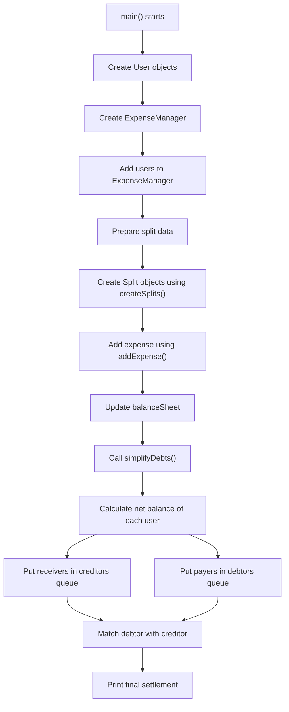

# Expense Tracker Project Notes

## 1. Project Idea

This project is a small Splitwise-style expense tracker.

It answers this question:

> If one person pays money for a group, how much should each person finally pay or receive?

The project supports three types of splits:

- `EQUAL`: amount is divided equally among selected users.
- `EXACT`: each user's exact amount is given directly.
- `PERCENT`: each user's share is calculated using percentage.

After recording expenses, the project simplifies debts. Instead of showing many small transactions, it calculates the final net amount for each user and prints a clean settlement plan.

Example:

```text
Rahul pays 3000
Priya pays 1500

Instead of settling both separately, the program calculates final net balances.
```

## 2. Main Flow Of The Program



## 3. Files In The Project

### `User.h`

Purpose:

Defines the `User` class.

Important code:

```cpp
class User
{
private:
    std::string id, name;

public:
    User(std::string id, std::string name);

    std::string getId()
    {
        return id;
    }

    std::string getName()
    {
        return name;
    }
};
```

Explanation:

- `User` represents a person in the expense tracker.
- Each user has:
  - `id`: unique identifier, like `"u1"`.
  - `name`: readable name, like `"Rahul"`.
- `id` and `name` are private, so outside code cannot directly modify them.
- Public getter methods are used to access the values safely.

OOP principle used:

- Encapsulation: data members are private.
- Abstraction: outside code uses `getId()` and `getName()` without knowing internal storage details.

### `User.cpp`

Purpose:

Implements the `User` constructor.

Important code:

```cpp
User::User(std::string id, std::string name) : id(id), name(name) {}
```

Explanation:

- This constructor runs when a `User` object is created.
- Example:

```cpp
User u1("u1", "Rahul");
```

- `"u1"` is stored in the object's `id`.
- `"Rahul"` is stored in the object's `name`.
- The syntax `: id(id), name(name)` is called a member initializer list.

Why member initializer list is used:

- It initializes data members directly.
- It is cleaner and usually more efficient than assigning inside the constructor body.

### `Split.h`

Purpose:

Defines the base class `Split` and three derived split classes.

Important code:

```cpp
class Split
{
public:
    std::string userId;
    double amount;

    Split(std::string userId, double amt = 0.0) : userId(userId), amount(amt) {}

    virtual ~Split() = default;
};
```

Explanation:

- `Split` stores common information needed for any split:
  - `userId`: who is part of the split.
  - `amount`: how much that user should pay.
- `Split` is the base class.
- `EqualSplit`, `ExactSplit`, and `PercentSplit` inherit from it.

Derived classes:

```cpp
class EqualSplit : public Split
{
public:
    EqualSplit(std::string id, double amt) : Split(id, amt) {}
};
```

`EqualSplit` is used when total money is divided equally.

```cpp
class ExactSplit : public Split
{
public:
    ExactSplit(std::string id, double amt) : Split(id, amt) {}
};
```

`ExactSplit` is used when every user's exact amount is already known.

```cpp
class PercentSplit : public Split
{
public:
    double percent;

    PercentSplit(std::string id, double p, double amt = 0.0) : Split(id, amt), percent(p) {}
};
```

`PercentSplit` is used when the split is based on percentage.

Important line:

```cpp
virtual ~Split() = default;
```

This is a virtual destructor. It is important because the program stores derived objects using base class pointers:

```cpp
std::vector<Split *> s1;
```

When we later call:

```cpp
delete s;
```

the virtual destructor ensures correct cleanup through the base pointer.

OOP principle used:

- Inheritance: `EqualSplit`, `ExactSplit`, and `PercentSplit` inherit from `Split`.
- Polymorphism: derived split objects are stored as `Split*`.

### `ExpenseManager.h`

Purpose:

Declares the main manager class that stores users, expenses, and balances.

Important code:

```cpp
enum ExpenseType
{
    EQUAL,
    EXACT,
    PERCENT
};
```

Explanation:

- `enum` is used to represent the type of split.
- Instead of passing strings like `"equal"` or `"percent"`, the code uses fixed values.
- This reduces mistakes and makes the code easier to read.

Important private data:

```cpp
std::unordered_map<std::string, User *> userMap;
std::unordered_map<std::string, std::unordered_map<std::string, double>> balanceSheet;
```

`userMap`:

```text
user id -> User pointer
```

Example:

```text
"u1" -> Rahul
"u2" -> Priya
"u3" -> Amit
```

`balanceSheet`:

```text
person A -> person B -> amount
```

Example:

```text
balanceSheet["u1"]["u2"] = 1000
```

Meaning:

```text
u2 owes u1 1000
```

Public methods:

```cpp
void addUser(User *user);
void addExpense(std::string payerId, double totalAmount, const std::vector<Split *> &splits);
void simplifyDebts();
void showBalances();
```

Explanation:

- `addUser()` stores users in the manager.
- `addExpense()` records an expense and updates balances.
- `simplifyDebts()` calculates final settlement.
- `showBalances()` prints current balances before simplification.

Factory method:

```cpp
static std::vector<Split *> createSplits(
    double totalAmount,
    const std::vector<std::pair<std::string, double>> &data,
    ExpenseType type
);
```

Explanation:

- This method creates split objects.
- It is `static`, so we can call it without creating an object:

```cpp
ExpenseManager::createSplits(total, data, EQUAL);
```

Design pattern used:

- Factory Method: object creation is centralized in one function.

### `ExpenseManager.cpp`

This file contains the actual logic of the project.

#### `addUser()`

```cpp
void ExpenseManager::addUser(User *user) { userMap[user->getId()] = user; }
```

Explanation:

- Takes a `User*`.
- Gets the user's id.
- Stores the user in `userMap`.

Example:

```cpp
manager.addUser(&u1);
```

If `u1` is Rahul:

```text
userMap["u1"] = address of Rahul object
```

#### `addExpense()`

```cpp
void ExpenseManager::addExpense(std::string payerId, double totalAmount, const std::vector<Split *> &splits)
{
    for (auto *split : splits)
    {
        if (payerId != split->userId)
        {
            balanceSheet[payerId][split->userId] += split->amount;
            balanceSheet[split->userId][payerId] -= split->amount;
        }
    }
}
```

Purpose:

Records who paid and who owes money.

Important parameters:

- `payerId`: id of the person who paid the money.
- `totalAmount`: total paid amount. In the current code this parameter is not directly used inside the function because each split already contains its calculated amount.
- `splits`: list of people included in the expense and their share.

Line-by-line:

```cpp
for (auto *split : splits)
```

Loops through all split participants.

```cpp
if (payerId != split->userId)
```

Skips the payer. A person does not owe money to themselves.

```cpp
balanceSheet[payerId][split->userId] += split->amount;
```

Means:

```text
split user owes payer this amount
```

Example:

```text
Rahul paid 3000
Priya share = 1000
```

Then:

```text
balanceSheet["u1"]["u2"] += 1000
```

Meaning:

```text
Priya owes Rahul 1000
```

```cpp
balanceSheet[split->userId][payerId] -= split->amount;
```

This stores the reverse side of the same debt.

Meaning:

```text
From Priya's side, Priya has -1000 balance with Rahul
```

Why both positive and negative values are stored:

- It makes net balance calculation easier later.
- Positive means the user should receive money.
- Negative means the user should pay money.

#### `showBalances()`

```cpp
void ExpenseManager::showBalances()
{
    std::cout << "\n--- Current Balances ---" << std::endl;

    bool hasBalances = false;
    for (auto const &[fromUserId, balances] : balanceSheet)
    {
        for (auto const &[toUserId, amount] : balances)
        {
            if (amount > 0.01)
            {
                hasBalances = true;
                std::cout << userMap[toUserId]->getName() << " owes "
                          << userMap[fromUserId]->getName() << " : "
                          << amount << std::endl;
            }
        }
    }

    if (!hasBalances)
        std::cout << "No pending balances." << std::endl;
}
```

Purpose:

Prints the current direct balances stored in the balance sheet.

Important idea:

- It prints only positive amounts.
- If `balanceSheet["u1"]["u2"] = 1000`, then Priya owes Rahul 1000.
- The negative reverse entry is ignored while printing to avoid duplicate output.

#### `createSplits()`

```cpp
std::vector<Split *> ExpenseManager::createSplits(
    double totalAmount,
    const std::vector<std::pair<std::string, double>> &data,
    ExpenseType type
)
```

Purpose:

Creates the correct type of split object based on `ExpenseType`.

Input data format:

```cpp
std::vector<std::pair<std::string, double>>
```

Each pair contains:

```text
user id, value
```

The meaning of `value` changes based on split type:

- For `EQUAL`, value is ignored.
- For `EXACT`, value means exact amount.
- For `PERCENT`, value means percentage.

Equal split:

```cpp
splits.push_back(new EqualSplit(id, totalAmount / data.size()));
```

Example:

```text
total = 3000
users = 3
share = 3000 / 3 = 1000
```

Exact split:

```cpp
splits.push_back(new ExactSplit(id, value));
```

Example:

```text
Rahul = 1500
Priya = 1000
Amit = 500
```

Percent split:

```cpp
splits.push_back(new PercentSplit(id, value, (value * totalAmount) / 100.0));
```

Example:

```text
total = 3000
Priya = 30%
amount = 30 * 3000 / 100 = 900
```

Important C++ concept:

```cpp
new EqualSplit(...)
```

creates an object on the heap. That is why the code later uses:

```cpp
delete s;
```

#### `simplifyDebts()`

```cpp
void ExpenseManager::simplifyDebts()
{
    std::unordered_map<std::string, double> netBalances;
    for (auto const &p : balanceSheet)
        for (auto const &s : p.second)
            netBalances[p.first] += s.second;
```

Purpose of this first part:

Calculates the final net balance of each user.

Example:

```text
Rahul should receive 1000 from Priya
Rahul should pay 500 to Priya

Rahul net = +500
Priya net = -500
```

Next part:

```cpp
std::priority_queue<std::pair<double, std::string>> creditors, debtors;
```

Explanation:

- `creditors`: people who should receive money.
- `debtors`: people who should pay money.
- `priority_queue` keeps the largest amount on top.

```cpp
for (auto const &[id, bal] : netBalances)
{
    if (bal > 0.01)
        creditors.push({bal, id});
    else if (bal < -0.01)
        debtors.push({-bal, id});
}
```

Explanation:

- If balance is positive, the user should receive money.
- If balance is negative, the user should pay money.
- For debtors, the code stores `-bal` to make it positive.

Final settlement loop:

```cpp
while (!creditors.empty() && !debtors.empty())
{
    auto c = creditors.top();
    creditors.pop();
    auto d = debtors.top();
    debtors.pop();
    double amt = std::min(c.first, d.first);
```

Explanation:

- Takes the biggest creditor and biggest debtor.
- Settles the smaller of the two amounts.

Example:

```text
Rahul should receive 1500
Amit should pay 1500

settlement amount = min(1500, 1500) = 1500
```

Printing:

```cpp
std::cout << userMap[d.second]->getName() << " pays "
          << userMap[c.second]->getName() << " : " << amt << std::endl;
```

Meaning:

```text
debtor pays creditor : amount
```

Remaining balance:

```cpp
if (c.first - amt > 0.01)
    creditors.push({c.first - amt, c.second});
if (d.first - amt > 0.01)
    debtors.push({d.first - amt, d.second});
```

Explanation:

- If creditor still needs more money, push them back.
- If debtor still owes more money, push them back.
- This continues until all balances are settled.

## 4. `main.cpp` Explanation

### Header includes

```cpp
#include "ExpenseManager.h"
#include "Split.h"
#include <iostream>
#include <vector>
```

Explanation:

- `ExpenseManager.h`: needed to use `ExpenseManager`, `User`, and `ExpenseType`.
- `Split.h`: needed for `Split*`.
- `<iostream>`: needed for `std::cout`.
- `<vector>`: needed for `std::vector`.

### Creating users

```cpp
User u1("u1", "Rahul"), u2("u2", "Priya"), u3("u3", "Amit");
double total = 3000.0;
```

Explanation:

- Creates three users.
- `total` is used in the first three scenarios.

### Why each scenario uses braces

Example:

```cpp
{
    ExpenseManager manager;
    ...
}
```

Explanation:

- Braces create a separate scope.
- Each scenario gets a fresh `ExpenseManager`.
- Old balances do not mix with the next scenario.
- When the block ends, local objects are destroyed automatically.

This demonstrates RAII and scope-based lifetime.

## 5. Scenario Notes

### Scenario 1: Equal Split

Code idea:

```cpp
Rahul pays 3000
Split among Rahul, Priya, Amit equally
```

Calculation:

```text
3000 / 3 = 1000 each
```

Rahul paid the full amount, so he does not owe himself.

Final result:

```text
Priya pays Rahul : 1000
Amit pays Rahul : 1000
```

### Scenario 2: Percent Split

Code idea:

```cpp
Rahul pays 3000
Rahul = 50%
Priya = 30%
Amit = 20%
```

Calculation:

```text
Rahul share = 1500
Priya share = 900
Amit share = 600
```

Rahul already paid, so only Priya and Amit owe him.

Final result:

```text
Priya pays Rahul : 900
Amit pays Rahul : 600
```

### Scenario 3: Exact Split

Code idea:

```cpp
Rahul pays 3000
Rahul's share = 1500
Priya's share = 1000
Amit's share = 500
```

Final result:

```text
Priya pays Rahul : 1000
Amit pays Rahul : 500
```

### Scenario 4: Multiple Transactions

Transaction 1:

```text
Rahul pays 3000
Split equally among 3 users
Each share = 1000
```

Balances:

```text
Priya owes Rahul 1000
Amit owes Rahul 1000
```

Transaction 2:

```text
Priya pays 1500
Split equally among 3 users
Each share = 500
```

Balances:

```text
Rahul owes Priya 500
Amit owes Priya 500
```

Net result:

```text
Rahul: +1000 +1000 -500 = +1500
Priya: -1000 +500 +500 = 0
Amit: -1000 -500 = -1500
```

Final simplified settlement:

```text
Amit pays Rahul : 1500
```

Important interview point:

The program does not settle each transaction separately. It combines all transactions and settles only the final net balances.

### Scenario 5: User Excluded From Split

Code idea:

```cpp
Rahul pays 1000
Only Priya and Amit are included in the split
```

Calculation:

```text
1000 / 2 = 500
```

Rahul is the payer but not part of the split.

Final result:

```text
Priya pays Rahul : 500
Amit pays Rahul : 500
```

## 6. OOP Principles Used Separately

### Encapsulation

Encapsulation means wrapping data and methods inside a class and restricting direct access to internal data.

Used in:

```cpp
class User
{
private:
    std::string id, name;
};
```

The user id and name are private. Outside code must use:

```cpp
getId()
getName()
```

Also used in `ExpenseManager`:

```cpp
private:
    std::unordered_map<std::string, User *> userMap;
    std::unordered_map<std::string, std::unordered_map<std::string, double>> balanceSheet;
```

The balance sheet is private, so outside code cannot corrupt balances directly.

Interview line:

> I used encapsulation by keeping user details and balance data private, and exposing controlled public methods like addUser, addExpense, and simplifyDebts.

### Abstraction

Abstraction means hiding complex implementation details and exposing a simple interface.

Used in:

```cpp
manager.addExpense("u1", total, s1);
manager.simplifyDebts();
```

The caller does not need to know:

- how balances are stored,
- how net balances are calculated,
- how priority queues are used,
- how final settlement is generated.

Interview line:

> The user of ExpenseManager only calls high-level methods. The internal debt calculation and simplification logic is hidden inside the class.

### Inheritance

Inheritance means one class derives from another and reuses its properties.

Used in:

```cpp
class EqualSplit : public Split
class ExactSplit : public Split
class PercentSplit : public Split
```

`Split` is the base class. The three split classes are derived classes.

Common properties inherited:

```cpp
userId
amount
```

Interview line:

> I used inheritance to create a common Split base class and specialized split types such as EqualSplit, ExactSplit, and PercentSplit.

### Polymorphism

Polymorphism means using a base class pointer or reference to handle different derived class objects.

Used in:

```cpp
std::vector<Split *> s1;
```

This vector can store:

- `EqualSplit*`
- `ExactSplit*`
- `PercentSplit*`

Even though the actual objects are different, they are handled uniformly as `Split*`.

Also supported by:

```cpp
virtual ~Split() = default;
```

Interview line:

> I used polymorphism by storing different split type objects in a vector of base class pointers, allowing the ExpenseManager to process all split types through a common interface.

## 7. Design Pattern Used

### Factory Method Pattern

Used in:

```cpp
ExpenseManager::createSplits(...)
```

Purpose:

Instead of creating objects manually everywhere:

```cpp
new EqualSplit(...)
new ExactSplit(...)
new PercentSplit(...)
```

the program calls one factory method:

```cpp
ExpenseManager::createSplits(total, data, EQUAL);
```

Benefits:

- object creation logic is centralized,
- main code becomes cleaner,
- adding new split types becomes easier.

Interview line:

> I used the Factory Method pattern to create different Split objects based on the expense type, so the client code does not need to know the exact object creation details.

## 8. C++ Concepts Used

### Classes and Objects

Classes:

- `User`
- `Split`
- `EqualSplit`
- `ExactSplit`
- `PercentSplit`
- `ExpenseManager`

Objects:

```cpp
User u1("u1", "Rahul");
ExpenseManager manager;
```

### Constructor

Used to initialize objects.

Example:

```cpp
User::User(std::string id, std::string name) : id(id), name(name) {}
```

### Pointers

Used here:

```cpp
User *user
std::vector<Split *>
```

Reason:

- Users are stored by address.
- Split objects are created dynamically using `new`.
- Base class pointers allow polymorphism.

### Dynamic Memory Allocation

Used here:

```cpp
new EqualSplit(...)
```

Cleaned up using:

```cpp
delete s;
```

Interview note:

In modern C++, `std::unique_ptr<Split>` would be safer than raw pointers because it would avoid manual `delete`.

### STL Vector

Used here:

```cpp
std::vector<Split *>
std::vector<std::pair<std::string, double>>
```

Purpose:

- stores lists of splits,
- stores input data for users and their amounts or percentages.

### STL Pair

Used here:

```cpp
std::pair<std::string, double>
```

Purpose:

Stores two values together:

```text
user id + amount/percentage
```

### Unordered Map

Used here:

```cpp
std::unordered_map<std::string, User *> userMap;
```

Purpose:

Fast lookup by user id.

Used also for nested balances:

```cpp
std::unordered_map<std::string, std::unordered_map<std::string, double>> balanceSheet;
```

### Priority Queue

Used here:

```cpp
std::priority_queue<std::pair<double, std::string>> creditors, debtors;
```

Purpose:

- always pick the person with the highest receivable amount,
- always pick the person with the highest payable amount,
- settle them greedily.

### Range-Based For Loop

Used here:

```cpp
for (auto *split : splits)
```

Purpose:

Cleaner iteration over containers.

### Structured Bindings

Used here:

```cpp
for (auto const &[id, value] : data)
```

Purpose:

Directly unpack pair values into named variables.

Requires C++17.

## 9. Makefile Notes

Important lines:

```make
CXX = g++
CXXFLAGS = -std=c++17 -Wall
TARGET = expense_tracker
SRCS = main.cpp ExpenseManager.cpp User.cpp
```

Explanation:

- `g++` is used as the compiler.
- `-std=c++17` enables C++17 features like structured bindings.
- `-Wall` enables compiler warnings.
- Output executable is `expense_tracker`.

Build and run:

```bash
make
```

Clean generated files:

```bash
make clean
```

## 10. Short Interview Explanation

Use this when interviewer says: "Explain your project."

```text
This is a C++ expense tracker inspired by Splitwise. I created User, Split, and ExpenseManager classes. Users represent people, Split represents a user's share in an expense, and ExpenseManager handles users, expenses, balances, and debt simplification.

The project supports equal, exact, and percentage splits. I used inheritance by creating EqualSplit, ExactSplit, and PercentSplit from a common Split base class. I used polymorphism by storing these derived objects as Split pointers. I also used a factory method to create the correct split objects based on the split type.

For each expense, the payer and participant shares are recorded in a balance sheet. At the end, simplifyDebts calculates each user's net balance. Positive balances become creditors and negative balances become debtors. Then I use priority queues to match the largest debtor with the largest creditor and print a simplified settlement plan.
```

## 11. Possible Interview Questions And Answers

### Why did you use a separate `ExpenseManager` class?

Because it keeps all expense-related operations in one place. It manages users, stores balances, creates splits, and simplifies debts.

### Why is `balanceSheet` private?

Because balance data should not be modified directly from outside the class. This protects the internal state and supports encapsulation.

### Why did you use inheritance for splits?

Because equal, exact, and percent splits are different forms of the same concept: a split. They share common data like `userId` and `amount`.

### Why did you use a factory method?

To centralize object creation. The main function does not need to know how to create each split type manually.

### Why is the destructor in `Split` virtual?

Because derived objects are deleted through base class pointers. A virtual destructor ensures correct cleanup.

### What data structure is used for debt simplification?

Two priority queues are used:

- one for creditors,
- one for debtors.

This helps settle the largest amounts first.

### What happens in multiple transactions?

The program stores all transactions in the balance sheet, calculates final net balances, and then prints the minimum simplified settlement.

### What improvement can be made?

Raw pointers can be replaced with smart pointers like `std::unique_ptr`. Validation can also be added to check exact split totals and percentage totals.

